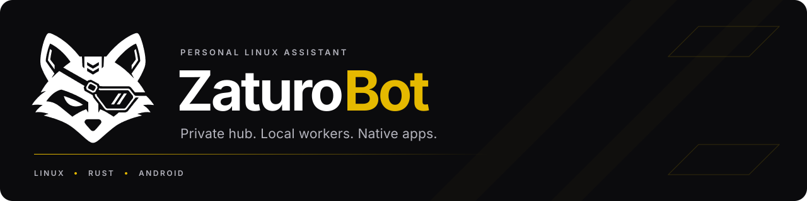

# ZaturoBot

[](https://github.com/AlexandreZanata/ZaturoBot/actions/workflows/check.yml)
[](apps/zaturo-desktop/README.md)
[](mobile/android/README.md)
[](deploy/mcp/README.md)

A personal Linux assistant with a private coordination hub, outbound workers, and native
Linux/Android clients. Durable tasks, explicit permissions, bounded execution, and
interruption recovery form the shared foundation. The hub stays lightweight; models,
media processing, and authorized USB operations run on a worker.

Version0.6 adds bounded semantic Linux/browser tasks and a social-management foundation.
It retains bounded DeepSeek conversation in both native clients, generation-only
YoutubeBot commands, a shared task area with a compact local MCP, and an Android private
phone viewer. Read [assistant and shared tasks](docs/ASSISTANT_AND_SHARED_TASKS.md) for
the current contracts. Read [computer use](docs/COMPUTER_USE.md) and
[social management](docs/SOCIAL_MANAGEMENT.md) for0.6 setup and precise supported actions. The [0.4 engineering report](docs/NATIVE_SERVICE_REPORT.md) remains
historical evidence; physical-device/account acceptance is recorded separately.

## Implemented capabilities

- Durable diagnostic tasks, leases, idempotency, owner controls, and bounded restart
  recovery. A direct diagnostic needs no model key.
- A bounded public-coding diagnostic using only the owner-authorized
  `deepseek-v4.1-flash` route, with independent tool policy and durable token admission.
- Encrypted resumable files between independently enrolled Linux devices through the
  private VPS relay. Workers save verified files without executing them or sending them
  to a model.
- A Rust/Slint Linux desktop and native Kotlin Android companion with persistent chat,
  day/type/search filters, worker status, and bounded text conversation. Known explicit
  commands dispatch typed work without inference; model replies cannot execute actions.
- A four-tool local MCP and revisioned shared task board for owner-requested coding-agent
  handoffs. Received instructions and file references are inert until locally authorized.
- A fixed YoutubeBot JSON service boundary with durable operation fencing, independent
  heavy-job units, and actual completion notices. The existing extension, recorder,
  generation, and upload pipeline remains in its own project. Generation-only requests
  check actual browser login evidence and never authorize publication.
- Serial-bound Android USB status and finite private screenshot/change-watch requests.
  Desktop and Android private viewers use short-lived endpoint-encrypted RAM delivery,
  separate from normal files/feed/history. Explicit messaging-app opening requires a
  separate local grant. This is not an SMS semantic detector.

Engineering artifacts are English; owner interface copy defaults to Brazilian Portuguese.
Start with [AGENTS.md](AGENTS.md) when changing code and the
[documentation map](docs/README.md) for contracts.

## Run the core locally

Install the pinned Rust toolchain and native build prerequisites. Bundled SQLite needs a
C compiler; building the desktop additionally needs the Linux UI prerequisites described
in its [README](apps/zaturo-desktop/README.md). Generate distinct local tokens and supply
the same relevant values securely to each terminal. Applications do not load `.env`
automatically.

```bash
export ZATURO_OWNER_TOKEN="$(openssl rand -hex 32)"
export ZATURO_WORKER_TOKEN="$(openssl rand -hex 32)"
cargo build --locked -p zaturo-hub -p zaturo-worker
cargo run -p zaturo-hub -- serve
```

In a worker-configured terminal:

```bash
cargo run -p zaturo-worker -- connect
```

In an owner-configured terminal:

```bash
cargo run -p zaturo-hub -- task create --kind diagnostic --target local-worker \
  --idempotency-key first-diagnostic
cargo run -p zaturo-hub -- task list
cargo run -p zaturo-hub -- task show TASK_ID
cargo run -p zaturo-hub -- workers list
```

Replace `TASK_ID` with the returned UUID. Default examples are
[hub](config/hub.example.toml) and [worker](config/worker.example.toml); both apps accept
`--config PATH`. Use `task pause`, `task resume`, or `task cancel` with an eligible
nonterminal task. Hub and worker retain separate SQLite databases.

A model-assisted task additionally requires the protected worker-local configuration,
provider key, explicit public-coding/Global-processing authorization, and advertised
`agent.diagnostic.v1` capability. Read [provider policy](docs/LLM_PROVIDERS.md).
Fake models are test fixtures, never a hidden production fallback.

## Native clients and existing devices

Build/run the desktop with `cargo build --release --locked -p zaturo-desktop` and
`target/release/zaturo-desktop`. It uses a separate scoped application credential and
the existing private tunnel or an HTTPS origin. Build/enroll the Android debug app using
[its README](mobile/android/README.md); no credential is embedded in the APK. Its own
restricted, host-pinned SSH transport was tested, but physical-phone acceptance remains.

The already-enrolled work PC's 0.3 installation remains valid. Update it additively through
[work services](deploy/services/WORK_SERVICES.md); keep its worker identity, private
SSH/age keys, inbox, and journal. **Do not re-enroll it.** The destination Codex performs
the pinned update and private-data restoration. All eight encrypted archive parts and
three metadata deliveries have reached that existing device; delivery alone does not
mean source overlays were applied or services upgraded.

Installed Linux profiles provide `~/.local/bin/zaturo` for `files peers`, `files send`,
`files list`, and `task diagnostic`. See [file contracts](docs/FILE_TRANSFERS.md),
[historical 0.3 measurements](docs/FILE_TRANSFER_REPORT.md), and
[current live operations](docs/LIVE_DEPLOYMENT.md). Both PCs connect outbound through
restricted SSH on port 22; no home-router port forwarding or public control API is needed.

YoutubeBot uses the reviewed revision and passing CI linked in the
[0.4 report](docs/NATIVE_SERVICE_REPORT.md). Google/ChatGPT sign-in and exact channel
verification remain interactive. No live generation/upload is claimed by a fixture test.
Private phone viewing requires the registered USB phone, an explicit grant, and an
already unlocked permitted screen. Opening its messaging app is a separate confirmed action.
There is no OCR, OTP extraction, automatic sign-in, or lock/secure-window bypass.

## Validate and review

```bash
cargo xtask check --locked
cargo xtask arch
cargo xtask docs
cargo xtask secrets
```

The 0.6 local gate passed **217 Rust tests and 89 Python helper tests**, plus strict
formatting/Clippy, documentation/architecture/registry checks, publication guard, and
rustdoc. Desktop release and Android debug APK builds provide build evidence; they do
not replace real Google/video or physical Android acceptance. The six-page
[system design PDF](output/pdf/zaturobot-system-design.pdf) was rendered and reviewed.

Current results are in the [0.4 report](docs/NATIVE_SERVICE_REPORT.md). Earlier
[foundation](docs/ENGINEERING_REPORT.md) and [Phase 2](docs/PHASE2_REPORT.md) reports
remain historical evidence. The 100-task local foundation benchmark observed 8.30 MiB
idle hub RSS and 9.11 MiB peak RSS; it is not an Oracle capacity guarantee for 0.4.

## Scope and license

The owner authorized Phases 0–2, encrypted cross-network files, bounded multiple workers,
private deployment/publication, and the explicit native-client/YoutubeBot/Android slices.
Full desktop automation, general vault, recurring scheduling, arbitrary project editing,
and unrestricted account actions remain [planned](docs/ROADMAP.md). Operational keys,
tokens, account data, databases, backups, and enrollment bundles stay private and untracked.

Dual MIT OR Apache-2.0 remains a recommendation pending the owner's license adoption
([ADR-0007](docs/DECISIONS.md)); no license grant is inferred from repository visibility.
